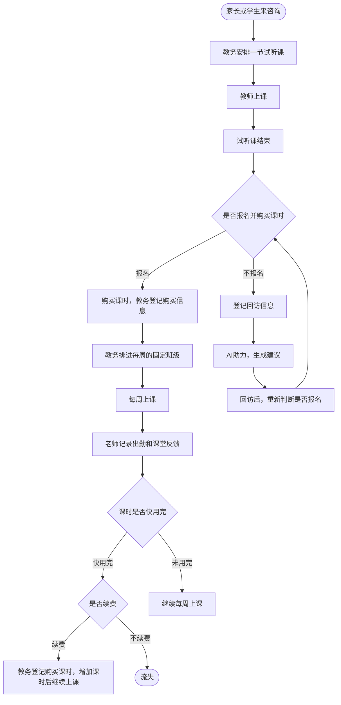

# 业务描述
需要设计一个学生管理系统，供教育机构使用；
这个系统包含了三种人物角色：教务，教师，学生；
整个招生到教学的流程如下：

AI助力功能：
   对于试听课结束后，不买课的情况，教务需要跟踪回访，尽可能地帮助到学生，解决学生的问题，会对学生或家长进行回访，通过回访的内容，可借助AI的能力，将学生信息和回访的内容喂到大模型模版，让大模型生成建议，帮助教务和学生家长沟通以及在学校内部优化课程等
# 数据模型
## 教务表
Id
姓名
头像
性别
出生年月日
联系方式
账号
密码
创建时间
更新时间
创建人
更新人
## 学生表
Id
姓名
学号
性别
出生年月日
年级
联系方式
家长联系方式
创建时间
更新时间
创建人
更新人
## 课程顾问与学生关系表
课程顾问id
学生id
创建时间
更新时间
创建人
更新人
## 消费记录表
Id
学生id
课程顾问id
消费金额
课程类型
课时
创建时间
更新时间
创建人
更新人
## 试听课表
Id
顾问id
教师id
课程类型
课程时间段
学生姓名
学生出生年月日
联系方式
家长联系方式
是否买课
备注
创建时间
更新时间
创建人
更新人
## 回访登记表
试听课Id
回访信息(text类型)
创建时间
创建人
## AI助力表
试听课Id
AI助力信息(text类型)
创建时间
创建人
## 教师表
Id
教师姓名
头像
性别
出生年月日
联系方式
课程类型
账号
密码
创建时间
更新时间
创建人
更新人
## 课程类型表
Id
课程类型名称
创建时间
更新时间
创建人
更新人
## 班级表
Id
班级名称
教师id
课程类型
创建时间
更新时间
创建人
更新人
## 班级学生表
班级id
学生id
创建时间
更新时间
创建人
更新人
## 班级课时表
班级id
教师id
时间段
课程类型
课程主题
状态 （待上课，教师请假，已完成）
备注
创建时间
更新时间
创建人
更新人
## 签到表
班级课时表id
学生id
学生签到（已到，未到）
备注
创建时间
更新时间
创建人
更新人

# 前端页面
## 登录页面
   输入账号，密码，选择顾问/教师后 点击“登录”按钮即可
## 试听课页面（顾问权限）
    顶部操作：新增
    列表字段：
      顾问编号 顾问姓名 教师编号 教师姓名 课程类型 试听时间段 学生姓名 学生性别 学生出生年月日 联系方式 家长联系方式 是否已买课 备注 计划报名时间 时间 操作(编辑，回访记录)
   
     回访记录页面
     顶部展示： 学生姓名 课程类型 最新AI助力信息
     顶部操作： 登记回访内容，AI助力，历史AI助力内容
     列表字段：
        时间 回访内容 操作(删除)
## 消费记录登记页面（顾问权限）
    顶部操作： 新增，查询
    列表字段：
      学生姓名 学生联系方式 顾问编号 顾问姓名 消费金额 课程类型 课时 时间
## 学生页面（顾问权限）
    顶部操作：新增，查询
    列表字段：
       学生编号 学生姓名 学生性别 学生出生年月日 联系方式 家长联系方式 班级名称 教师编号 教师名称 已完成课时 剩余课时 操作(删除)
## 班级页面 （顾问权限）
    顶部操作：新增
    列表字段：
       班级名称 课程类型 教师编号 教师姓名 教师头像 教师性别 学生数量 操作(课时查看)

    课时查看弹框信息列表：
        周几 日期 时间段
## 班级课时页面（教师权限）
    顶部展示：班级名称 教师编号 教师姓名
    顶部操作：新增
    列表字段：
       周几 日期 时间段 备注
       操作：编辑。可改日期、周几、时间段、课程主题、状态、备注。同一天的时间段不能与本班其他课时重合。已有签到记录时不能改为请假。
## 班级学生页面 (教师权限)
    列表字段：
       学生编号 学生姓名 学生性别 学生出生年月日 联系方式 家长联系方式 顾问编号 顾问姓名 已完成课时 剩余课时 操作(历史课时)
      
    历史课时页面：
     顶部展示：学生编号 学生姓名
     列表字段：
        日期 周几 是否已到 备注
## 签到页面 (教师权限)
   一级页面：
   顶部展示：班级名称 教师编号 教师姓名 课程类型
   列表字段：
      周几 日期 课时 操作(签到)
    
   签到二级页面：
   顶部展示：班级名称 教师编号 教师姓名 课程类型 周几 课时
   列表字段：
      学生姓名 学生编号 是否新生 是否已到 剩余课时 备注 操作(查看学生信息，备注)
      备注列只展示。填写备注要点操作里的「备注」，在悬浮框里填写。
      是否已到是「未到」「已到」两个勾选，默认勾选未到。勾选后立即提交该学生，没有底部提交按钮。
# 关键规则
1.顾问负责收费登记，学生信息录入，分配学生到班级，创建班级
2.教师负责班级课时创建，学生签到
3.教师登录后，进入教师权限的相关页面，通过任何其他方式都不能进入顾问的相关页面
4.顾问登录后，进入顾问权限的相关页面，通过任何其他方式都不能进入教师的相关页面
5.本系统就教师和顾问两种角色，所有涉及数据删除修改的操作，都要严格遵守角色的权限限制
# 假设和问题
1.学生上课后中途要退款
2.付款后的上课时间安排是马上上课，还是可以推迟多久上课(比如学生这段时间没空)
3.学生报名后，参加的课可以中途上吗，还是走全新的课从头开始上
4.目前只有教师和顾问两种角色，是否还不足够，比如需要顶级管理员参看操作日志等
5.是否存在实体的教室，如果有，需要考虑教室占用情况，避免同时占用的冲突
# 技术栈
前端：React + Next.js + TypeScript
数据库：Mysql
部署：Docker